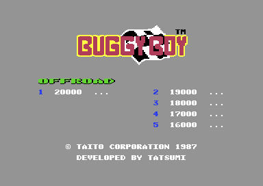
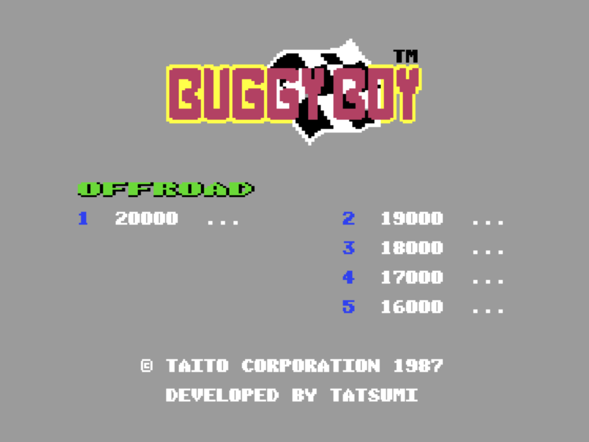
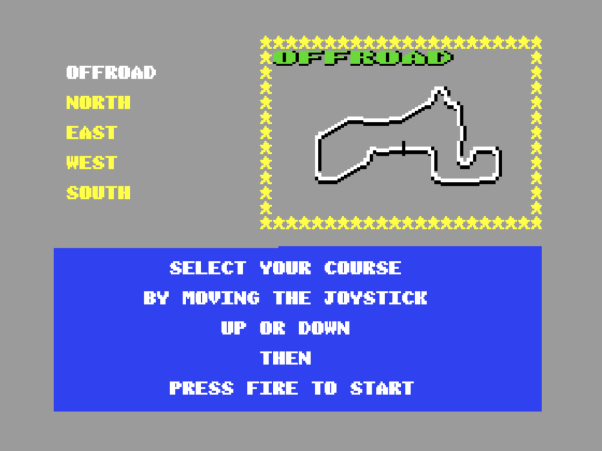
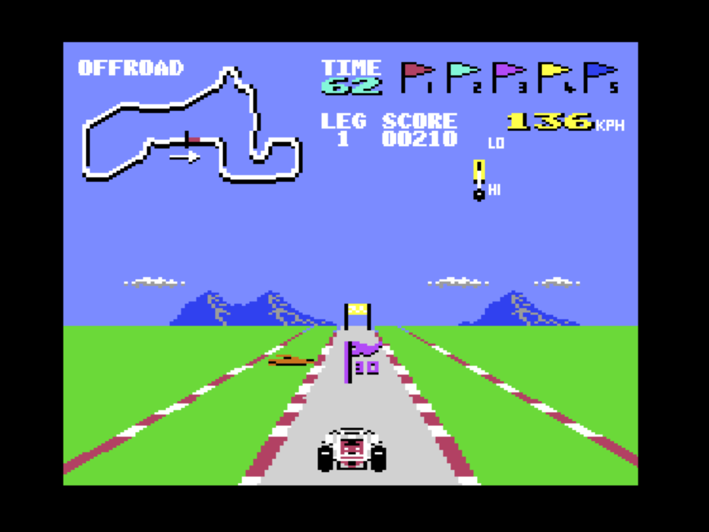

# Buggy Boy: C64 → MSX turbo R + V9990

An educational study in porting a Commodore 64 game to the MSX. The 6502
code of the C64 version of *Buggy Boy* is not emulated: it is **statically
translated** to Z80/R800 code. A small kernel stands in for the C64
hardware (VIC-II, SID, CIA, raster interrupts) on an MSX turbo R (R800,
memory mapper) with a V9990 (Gfx9000 or compatible) as the display.

**Please read the [disclaimer](DISCLAIMER.md) first.** This is a
non-commercial project for learning. It is not affiliated with or endorsed
by the owners of *Buggy Boy*.

## Screenshots

<table>
  <tr>
    <th>Commodore 64 (original)</th>
    <th>MSX turbo R + V9990 (this port)</th>
  </tr>
  <tr>
    <td></td>
    <td></td>
  </tr>
  <tr>
    <th>MSX course select</th>
    <th>MSX race</th>
  </tr>
  <tr>
    <td></td>
    <td></td>
  </tr>
</table>

## Repository layout

| Folder | What it holds |
|---|---|
| `disasm/` | da65 disassembly of the C64 game (`game.s`) and its loader intro (`intro.s`), with the `.info` files that drive da65. `game.s` is the input of the translator. |
| `tools/` | Reverse-engineering helpers used to produce `disasm/`. |
| `msx/` | The MSX port: translator, kernel, V9990 renderer, loader and tests. |
| `intro/` | Original MSX2 intro (SCREEN 5 wave parallax, sine scroller, PSG music). It runs before the game and asks you to switch to the V9990 output. |
| `docs/` | Screenshots. |

The renderer source is split into focused files under `msx/src/render/`.
`msx/src/render.asm` includes them in assembly order and keeps the renderer's
memory region contiguous for the build tool.

## Building

### Requirements

- Python 3 (standard library only)
- `make`
- `z80asm`, the Z80 assembler by Bas Wijnen (packaged as `z80asm` by most
  distributions). Other assemblers of the same name will not work.
- [openMSX](https://openmsx.org/) to run the result, with the system ROMs
  for the Panasonic FS-A1GT (turbo R) installed.

### Build the game ROM

    cd msx
    python3 tools/build.py

This runs the whole pipeline:

1. `tools/translate.py` rebuilds the C64 memory image from
   `disasm/game.s`, traces the code and translates it to Z80
   (`build/code.asm`, `build/dispatch.asm`, `build/translate.json`).
2. `z80asm` assembles `src/main.asm` (kernel, renderer, translated code,
   loader) into `build/main.bin`, with labels in `build/main.lbl`.
3. The binary is cut into 16K memory images and checked against the free
   areas of the C64 memory map.
4. `make` is run in `../intro`, and `intro.rom` is placed in ROM bank 15.
5. Everything is packed into `build/buggyboy.rom`, a 256K ASCII16 MegaROM.

### Build the intro on its own

    cd intro
    make            # gen_data.py -> data.inc, then intro.rom (16K, MSX2)
    make run        # runs it in openMSX on a Panasonic FS-A1F
    make clean

`openmsx` must be on your PATH. The test scripts and `intro/Makefile` also
accept `OPENMSX=/path/to/openmsx`.

Prebuilt ROMs are kept in git (`msx/build/buggyboy.rom`, `intro/intro.rom`).
Everything else in `msx/build/` and `intro/data.inc` is regenerated by the build.

### Regenerating the disassembly (optional)

`disasm/` is already in the repository; this is only needed to redo the
reverse engineering from an original C64 program file.

- `tools/unpack.py <prg> <out> <start>` loads a `.prg` into a minimal 6502
  emulator, runs the depacker from `<start>` and dumps the 64K memory image.
- `tools/stage2.py <mem> <out> <start> <stub_lo> <stub_hi>` runs a second
  depacker stage on a memory dump, until the PC leaves the stub area.
- `tools/trace.py <mem> <lo> <hi> <entry> <info_out>` traces the code
  reachable from `<entry>` and writes a da65 info file (`disasm/*.info`).
- `da65` (from cc65) turns the image plus the info file into the listing.

## Running

In openMSX, with a turbo R and the Gfx9000 extension:

    cd msx
    openmsx -machine Panasonic_FS-A1GT -ext gfx9000 -cart build/buggyboy.rom -romtype ASCII16

The ROM first plays the MSX2 intro on the normal MSX video output. Its
scroller asks you to switch to the V9990: select the Gfx9000 video output
(`set videosource GFX9000` in the console, or the openMSX menu), then press
any key or a joystick button to start the game.

On real hardware you need a turbo R (256K+ mapper RAM), a V9990 cartridge,
and the ROM in an ASCII16 MegaROM cartridge.

Controls: joystick in port 1, or cursor keys + SPACE (fire).
STOP = pause (C64 RUN/STOP), ESC = C64 "←" key.

## How it works

| Piece | File | What it does |
|---|---|---|
| Image + tracer | `msx/tools/c64image.py` | Rebuilds the C64 memory image from the listing, applies the crack's start-up patches, traces all code (including code only reachable through jump tables). |
| Translator | `msx/tools/translate.py` | 6502 → Z80: A→A, X→E (D=0), Y→C (B=0), N/Z→S/Z, carry polarity tracked lazily, flag liveness analysis, self-modifying operands read at run time. JMP-connected code stays in one 16K segment; JSR across segments goes through `k_farcall`. |
| Kernel | `msx/src/kernel_p0.asm`, `msx/src/kernel_p2.asm` | Lives in C64 pages that only held 6502 code. IM2 interrupt entry, memory helpers, VIC/SID/CIA register emulation, raster timing from the turbo R system timer, far calls, indirect-jump dispatch (hash table), SID→PSG with software ADSR, joystick/keyboard. |
| Renderer | `msx/src/render.asm`, `msx/src/render/` | Own mapper segment, runs at V9990 vblank. Draws dirty C64 cells (text, multicolour, bitmap) into V9990 B3 (512×212, 4bpp) at 3 pixels per C64 multicolour pixel, so the full 40-column screen fits with the right aspect ratio. Sprites are cached as shapes in VRAM and blitted, and the display is double buffered. |
| Intro | `intro/` | ROM bank 15, assembled for page 1. The loader maps it in from a RAM stub and calls its key entry (`$4010`, returns after a key press and release) on the Z80, before anything else. |
| Loader | `msx/src/loader.asm` | ROM bank 0: runs the intro, switches to R800, copies the images into mapper segments, takes over all four pages. |

Memory while the game runs: page 0 = C64 $0000-$3FFF, page 1 = translated
code (banked), page 2 = C64 $8000-$BFFF, page 3 = C64 $C000-$FFFF. The VIC
bank ($4000-$7FFF) is a separate segment reached through `k_vrd`/`k_vwr`,
which also keep the renderer's dirty bitmap (1 bit per 8 bytes).

Raster interrupts: a C64 raster line *c* becomes V9990 line interrupt *c−45*.
The translated handler runs from that interrupt, so writes to `$D020-$D023`
change V9990 palette entries at the right line (the road stripes). Any other
VIC register change is recorded in a per-frame timeline, and the renderer
uses it to pick the mode, colours and sprite set for each character row.
Handlers whose line was armed too late are run right away, or at the latest
at vblank, so the game keeps its 50 Hz rhythm.

### Reading the assembly

Start at `msx/src/main.asm`. It includes the shared constants, page-0 and
page-2 kernel code, renderer, translated game code, and cartridge loader.
`msx/src/defs.inc` defines mapper segments, device ports, display geometry, and
the kernel's shared RAM variables.

The renderer's include order in `msx/src/render.asm` follows its work for each
frame:

1. `state.inc` describes renderer RAM and the clean-playfield shadow.
2. `frame.asm` enters a frame, snapshots dirty flags, and starts the raster
   timeline.
3. `rows.asm` reads the raster state and prepares each character row.
4. `dirty.asm` finds changed cells and handles whole-cell and fine scrolling.
5. `draw.asm`, `colors.asm`, and `pixels.asm` select colours and convert C64
   cell pixels into V9990 data.
6. `commands.asm` sends V9990 drawing commands; `sprites.asm` draws sprites
   and synchronizes the double-buffered display pages.
7. `tables.asm` holds renderer lookup tables.

To follow one rendered row, trace `render_frame` → `renderer_setup_row` →
`renderer_find_dirty_cells` → `renderer_draw_dirty_cells`; after all rows,
`render_sprites` updates the back page. Routine comments describe important
input and output registers. Routine entry points use descriptive names, while
short labels inside a routine mark local branches. Generated translated-code
labels retain their C64 addresses because the translator and debug tools use
those addresses to identify game code.

## Known limitations

- The 4bpp palette has 12 free entries, so brown, light red, dark grey and
  light green are shown as orange, red, grey and green.
- Hires pixels are 1.5 V9990 pixels wide (two become `a, a|b, b`).
- Sprite-sprite collisions use shrunken bounding boxes, not pixels.
  Sprite-background priority and collisions are not emulated.
- SID sound is approximated on the PSG (square/noise, software envelope, no
  filter).

## Tests

Run from `msx/`. The intro waits for a key, so a test has to press one
(about 7 s after boot, once the intro is running) before the game starts.

- `test/run.sh <seconds> <out-prefix> [tcl]` boots the ROM headless in
  openMSX, optionally runs extra Tcl (key presses, breakpoints), samples the
  PC every 0.5 ms and prints a profile (`tools/symmap.py`,
  `tools/profgroup.py`).
- `test/mkdrive.sh <dir>` writes a Tcl script that leaves the intro, drives
  the buggy and measures the game's frame rate.

Debugging helpers in `msx/tools/`: `trace_samples.py` (PC samples in time
order), `vicrender.py` (reference VIC-II renderer for a C64 memory image),
`vram2png.py` (V9990 VRAM dump to image).
